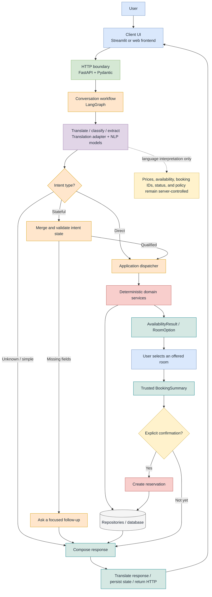

# Concierge.AI_v2
Multi-language, modular based chat support for guest-hotel interactions

# ConciergeAI Architecture

The diagram below is intentionally simplified for README use. The editable draw.io version contains the full framework mapping, intent lifecycle, and response routing.

