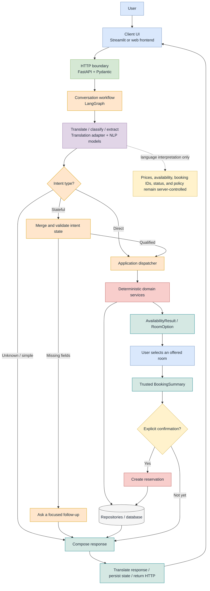

# Concierge.AI_v2
Multi-language, modular based chat support for guest-hotel interactions

# ConciergeAI Architecture

The diagram below is intentionally simplified for README use. The editable draw.io version contains the full framework mapping, intent lifecycle, and response routing.



## Installation

Concierge.AI_v2 supports Python 3.12 and Python 3.13. Create and activate a
virtual environment, then install the application from the repository root:

```shell
python -m pip install -e .
```

For development and tests, install the optional development dependencies:

```shell
python -m pip install -e ".[dev]"
```

The editable installation is intentional. The current application loads its
JSON data, README, favicon, Streamlit entry point, and local model artifacts
from this source checkout. A non-editable `pip install .` can build and install
the Python package, but the installed application does not yet relocate those
runtime files into the environment.

`pyproject.toml` is the single source of truth for Python dependencies. The
large model artifacts are not Python dependencies and are not included in the
package. They must be available separately at these project-local paths:

- `src/conversation/models/translation/model_data/nllb-200-distilled-600M/`
- `src/conversation/models/translation/model_data/lid.176.bin`
- `src/conversation/models/intent/model_data/intent-classifier/`
- `src/conversation/models/information/model_data/Qwen3-8B-Q4_K_M.gguf`

When `python run.py` starts, every missing model artifact is downloaded before
the API and client processes are launched. The same check can be run manually:

```shell
python -m conversation.models.translation.download_models
```

Model downloads remain separate from package installation and are stored only
in the project-local paths listed above.

The default dependency resolves the standard PyPI build of PyTorch. If a CUDA
build is required, install the matching `torch==2.11.0` build for the target
system before installing Concierge.AI_v2.

On Windows, `llama-cpp-python` may require a C/C++ build toolchain when pip
cannot find a compatible pre-built wheel.

## Streamlit concierge client

Start the API and Streamlit client together from the repository root:

```shell
python run.py
```

The Streamlit server address, port, headless mode, development mode, and
usage-statistics setting are explicit in `ApplicationSettings` as
`streamlit_host`, `streamlit_port`, `streamlit_headless`,
`streamlit_development_mode`, and `streamlit_gather_usage_stats`. The default
client URL is `http://127.0.0.1:8501`.

The launcher supervises the API and client as one process pair. If either
process exits during development, the other process is stopped and both are
started again so their runtime state stays synchronized.

To run only the guest client in a separate terminal, use:

```shell
python -m streamlit run src/client/app.py --global.developmentMode false --server.address 127.0.0.1 --server.port 8501
```

The client uses `http://127.0.0.1:8000/api/conversation` by default. Set
`CONCIERGE_API_URL` to another absolute URL ending in `/api/conversation` when
the API is hosted elsewhere. The client rejects URLs outside that route family.

Opening the page initializes a session automatically. If the guest submits a
message after that session has ended or before a session ID is available, the
client initializes a fresh session and then sends the already-entered message.
Messages, room-card selections, confirmations, inactivity termination, and
tab-close termination all use endpoints below `/api/conversation`. A lightweight
Streamlit fragment checks for 10 minutes without a submitted message or shortcut
and then closes the session.

Tab-close delivery uses `navigator.sendBeacon` on `pagehide`, with a
`fetch(..., keepalive=True)` fallback. Browser shutdown and mobile lifecycle
events cannot guarantee that either request reaches the API. The 10-minute
watchdog reliably handles an open but idle Streamlit page, but it cannot run
after the page has been destroyed. Guaranteed cleanup after a failed unload
request would require a server-side session TTL or cleanup job.
