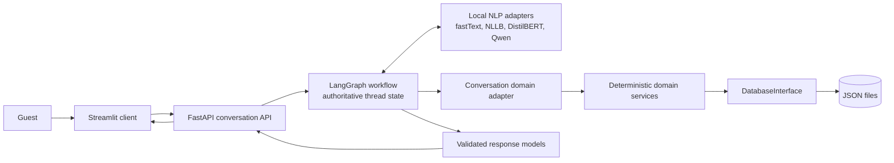
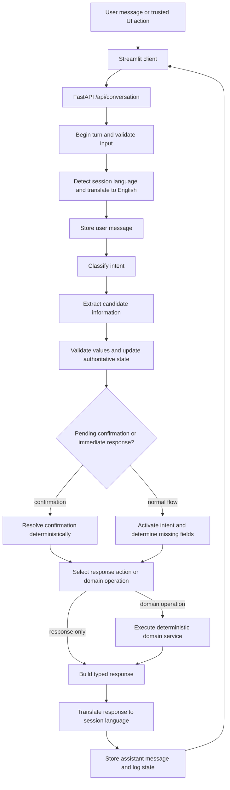

# Concierge.AI_v2 Technical Documentation

## 1. System Overview

Concierge.AI_v2 is a local multilingual chatbot for the fictional Harbour Light
Hotel. It supports availability checks, booking lookup, booking requests,
booking cancellation, and hotel-information questions.

Its central design principle is:

> AI interprets natural language. Deterministic application logic retains
> control over business-critical decisions.

The NLP components may propose an intent or extracted value, but they do not
decide room availability, prices, booking existence, booking identifiers, or
cancellation results.

## 2. Architecture

The application is divided into a guest client, an HTTP boundary, conversation
orchestration, local NLP adapters, deterministic domain services, and a data
layer.



Component responsibilities are deliberately narrow:

- **Streamlit** renders the transcript, hotel-information cards, room choices,
  booking summaries, and confirmation controls.
- **FastAPI** exposes the conversation endpoints and owns application-scoped
  dependencies through its lifespan.
- **LangGraph** coordinates each turn and stores authoritative conversation
  state per `thread_id` in an `InMemorySaver`.
- **NLP adapters** identify language, translate text, classify intent, and
  extract candidate information.
- **Domain services** apply availability, pricing, customer, booking, and
  cancellation rules.
- **`DatabaseInterface`** separates domain services from the current
  `JsonDatabase` implementation.

## 3. Request and Conversation Flow

The compiled graph is defined in `src/conversation/graph/builder.py`. The
following diagram omits minor persistence and error branches while preserving
the effective order of a normal turn.



New-session initialization returns a greeting without running the NLP pipeline.
Invalid input, termination, and recoverable error paths can also route directly
to response construction.

## 4. NLP Pipeline

### Language identification

fastText `lid.176.bin` identifies the source language when a session receives
its first normal message. The application keeps a short language code at its
boundary and stores the selected language in conversation state. If detection
fails or returns an unusable value, English is used as the safe domain-language
fallback.

Trusted room and information-topic selections carry validated wire values and
bypass language detection and translation.

### Translation

The active runtime translator is **NLLB-200 distilled 600M**. It maps short
language codes to NLLB/FLORES codes, translates guest input to English, and
translates responses back to the stored session language. Inference is local
and CPU-based by default.

The adapter uses an inference lock and a bounded LRU-style cache. Generation is
limited to 96 new tokens with one beam. A single-token source is restricted to
two new tokens to reduce unnecessary generated text. Translation failures keep
the original message available instead of terminating the session.

`m2m100_translator.py` remains as a non-selected compatibility adapter, but
application initialization constructs `NLLBTranslator`.

### Intent classification

The intent detector is a custom DistilBERT sequence-classification model loaded
from the external `floriankrauss/intent_detector_concierge` repository. It maps
English input to seven classes:

- `availability_check`;
- `booking_check`;
- `booking_request`;
- `booking_cancellation`;
- `information_request`;
- `conversation_initiation`;
- `unknown`.

Intent classification is separate from information extraction. The classifier
selects the likely workflow; it does not invent or validate booking data. The
model was developed separately with broader phrasing and hard-negative
boundaries intended to reduce keyword-only decisions. The training corpus and
training pipeline are not included in this runtime repository, so those
training details are provenance rather than locally reproducible artifacts.

### Information extraction

Structured extraction uses **Qwen3-8B-Q4_K_M GGUF** through
`llama-cpp-python`. The system prompt restricts output to a JSON schema and
explicitly prohibits guessing. Current date metadata may resolve an explicit
relative date, but it must not become extracted user information by itself.

Extractor output is untrusted. The graph validates its shape and values before
state mutation. Robustness mechanisms include:

- parsing exact numeric date replies directly from the original message;
- preferring the original message when a focused date answer or confirmation
  is expected;
- retaining both original and translated message content;
- running a controlled fallback extraction when requested fields remain
  missing;
- accepting an email only when it matches a literal address in the original
  message;
- parsing room and information-topic card selections deterministically.

## 5. Conversation Orchestration with LangGraph

`ConversationState` is the authoritative session record. It stores message
history, collected information, active intent, missing fields, expected
interactions, pending changes, availability state, and current-turn results.
Reducers merge messages by stable message ID and information by
`InformationField` without mutating caller-owned mappings.

The controller uses LangGraph's configurable `thread_id` as the conversation
session identifier. Checkpoints are kept in memory with a `JsonPlusSerializer`
and an explicit allowlist for application types. A process restart therefore
removes active conversation checkpoints but does not remove JSON bookings or
customers.

Graph behavior is split across focused modules under
`src/conversation/graph/nodes/`. There is no monolithic `nodes.py`. Conditional
routing handles missing data, immediate responses, confirmations, interruptions,
domain execution, termination, and recoverable error responses.

Expected interactions are explicit state values for booking confirmation,
cancellation confirmation, and information-change confirmation. A different
clear intent can interrupt a pending confirmation instead of being treated as
an accidental approval or rejection.

## 6. Information Validation and State Management

Candidate information is filtered and normalized before entering persistent
conversation state. Important rules include:

- check-in and check-out must be real dates and not be in the past;
- check-out must be later than check-in;
- reusing the already stored check-in or check-out date is reported with its
  existing role;
- a short yes/no answer can be mapped to the requested boolean field;
- a changed stored value may be held in `pending_information_changes` until the
  guest confirms replacement;
- required fields are derived from the active intent;
- booking availability is checked before room selection and is revalidated when
  relevant criteria change;
- booking creation and cancellation require explicit confirmation.

The graph also tracks an availability signature. A room selection is accepted
only with the immutable criteria carried by the trusted client action, while
state changes clear or replace stale availability validation.

## 7. Deterministic Domain Logic

The conversation layer selects a `DomainOperation`; `DatabaseDomainAdapter`
then converts validated fields into calls to existing domain services. The AI
models cannot authoritatively determine or invent:

- room availability;
- prices or breakfast charges;
- booking identifiers;
- whether a booking exists;
- whether a cancellation succeeded.

Availability is calculated from room category, in-service status, capacity,
accessibility, stay overlap, and booking status. Pricing uses `Money`, nightly
rates, stay length, guest count, and the stored breakfast price. Booking IDs are
created by the booking service, and booking lookup/cancellation use customer and
stay data from the database.

This boundary limits the effect of model errors: NLP can misunderstand a
message, but it cannot directly write a price or manufacture a successful
booking result.

## 8. Hybrid User Interface

Free text is useful for flexible, multilingual, and incomplete requests.
Deterministic UI controls are safer for discrete or business-critical choices.
The final client therefore combines both:

- natural-language input for intent and unstructured details;
- reusable hotel-information topic controls;
- room-category cards tied to validated availability criteria;
- explicit booking and cancellation buttons;
- structured booking summaries before confirmation.

The controls send compact validated wire messages. They are not displayed to
the guest and are parsed before the NLP models. This is a deliberate UX and
robustness decision rather than a replacement for conversational interaction.

## 9. Data Persistence

`DatabaseInterface` defines access to rooms, bookings, customers, breakfast
pricing, and hotel information. `JsonDatabase` implements that contract with:

- `data/hotel_assets.json` for hotel and room inventory;
- `data/hotel_information.json` for information topics;
- `data/bookings.json` for booking records;
- `data/customers.json` for customer records.

The fixture data describes the fictional Harbour Light Hotel. JSON access is
protected by an in-process reentrant lock, and writes use a temporary file plus
atomic replacement. This is distinct from LangGraph's in-memory conversation
checkpoints.

## 10. Model Management

Large models are excluded from the submission archive because the complete set
is about 7.4 GiB. `run.py` calls `ensure_models_available` before starting either
service. The utility downloads only missing configured files and reports the
current file, source URL, completion, or exception reason to the console.

| Component | Configured source | Approximate local size |
| --- | --- | ---: |
| NLLB translation model | `facebook/nllb-200-distilled-600M` | 2.31 GiB |
| fastText language detector | Facebook public model file | 0.12 GiB |
| Custom intent classifier | `floriankrauss/intent_detector_concierge` | 0.25 GiB |
| Qwen information extractor | `Qwen/Qwen3-8B-GGUF` | 4.68 GiB |

Repositories, URLs, filenames, and local paths are centralized in
`ApplicationSettings`. Hugging Face artifacts use `hf_hub_download`; the
fastText binary uses a temporary `.part` file and replaces the target only after
a successful download. After that, all inference is local.

## 11. Performance Considerations

The default deployment uses CPU inference. PyTorch is assigned half of the
detected logical CPUs for intra-op work, while the Qwen adapter has separate
generation and batch thread settings. The translation and intent adapters keep
bounded in-memory caches, and generation token limits constrain latency.

Model warm-up runs during FastAPI startup and logs each model's duration.
Warm-up failure is logged without making startup itself fail. The client shows a
localized patience message when a turn exceeds eight seconds. Initial API and
patience calls use HTTP timeouts; the main conversation-turn timeout is
unbounded in the current settings to allow slow local inference.

`run.py` waits for the API health endpoint before starting Streamlit and
supervises both child processes. These measures improve local usability but do
not make CPU inference equivalent to a production inference service.

## 12. Testing and Quality Assurance

The repository contains 85 test files and currently runs 630 unit tests. The
suite covers API schemas and routers, client behavior, LangGraph state and
routing, confirmations, original-message fallbacks, model adapters, domain
rules and services, JSON persistence, model downloads, logging, and startup
utilities.

Heavy model loading is deliberately disabled in unit tests; adapters are tested
with stubs and mocks. Live inference quality therefore remains a manual and
model-level validation concern rather than part of the default unit suite.

The final quality commands are:

```powershell
python -m pytest
python -m mypy src
python -m ruff check .
```

All were green at the final documentation pass. The optional standalone tool at
`tools/python-quality-dashboard/` can run and visualize the same categories of
checks, but it is not required by the application runtime.

## 13. Error Handling and Robustness

Recoverable failures generally return a guest-safe response while keeping the
session active. The graph rejects malformed model output, invalid domain
results, and incompatible checkpoint values. Translation, language detection,
intent classification, extraction, response construction, and domain calls
have explicit fallback or error boundaries.

Unknown intents increment a counter and eventually terminate an unproductive
session. Confirmation safeguards prevent ambiguous replies from executing a
booking or cancellation. A conflicting email identity receives a specific
response, and date validation distinguishes invalid dates from dates already
used in the current stay.

Structured logging records state and failures without exposing technical wire
messages in the guest interface.

## 14. Limitations

- CPU-only translation and extraction can have noticeable latency.
- The first run requires a network connection and substantial model downloads.
- Generative extraction and neural translation cannot be completely
  deterministic, even with strict prompting and validation.
- Intent-classifier coverage is finite, and its training corpus is maintained
  outside this runtime repository.
- Conversation checkpoints are process-local and disappear on restart.
- JSON persistence and in-process locking are appropriate for a local
  prototype, not concurrent multi-worker production use.
- The launcher and installer are Windows-oriented.
- The project does not provide production authentication, authorization,
  distributed session storage, or operational hardening.
